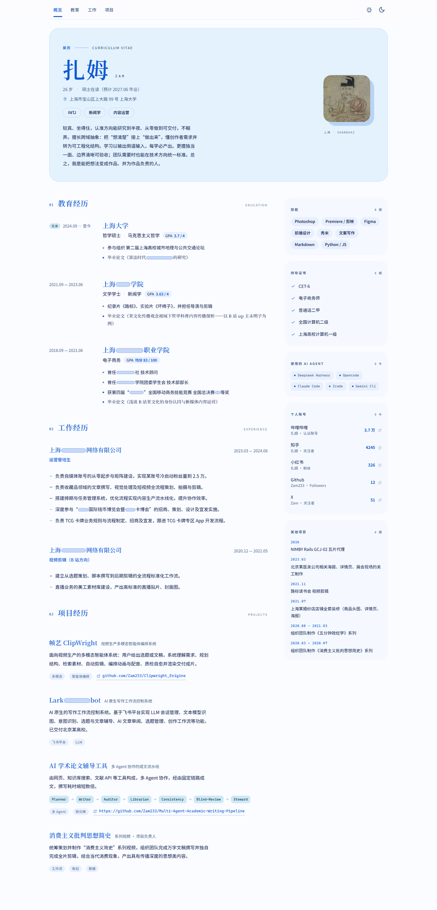

# 简历网页 · React + Sober / Material You

把 `../简历.pdf` 里的内容做成一个可交互的单页简历。数据在**构建期**注入，`frontend/dist` 就是纯静态产物，可以直接丢到 GitHub Pages（在线版：<https://zam233.github.io/Zam_Resume/>）。组件层使用 [Sober](https://soberjs.com/#/)（Material You / M3 的 Web Components 组件库）。



深色与移动端：[preview-desktop-dark.png](docs/preview-desktop-dark.png)、[preview-mobile.png](docs/preview-mobile.png)。
打印（浏览器 Ctrl+P）是两页 A4：[第 1 页](docs/preview-print-1.png)、[第 2 页](docs/preview-print-2.png)。

```
resume-web/
├─ backend/                 FastAPI：本地可选，只做数据校验
│  ├─ app/main.py           只读 JSON 接口 + 托管 dist
│  ├─ app/models.py         Pydantic 数据契约
│  └─ data/resume.json      ← 唯一的内容来源（前端在构建期 import 它）
├─ frontend/                React + Vite + TypeScript
│  ├─ src/data.ts           构建期注入 resume.json
│  ├─ src/export.ts         Markdown / JSON 导出（浏览器内生成）
│  ├─ src/components/       TopBar / Hero / Sections / Rail / BottomNav / Footer
│  ├─ src/styles/theme.css  M3 色板（浅色 + 深色）与 Sober token 覆盖
│  ├─ src/hooks.ts          主题持久化、滚动高亮
│  └─ public/assets/        肖像（从原 PDF 抽取）、.nojekyll
├─ docs/                    预览图
├─ .github/workflows/       GitHub Pages 自动部署
├─ start.ps1 / start.cmd    本地一条命令起服务
└─ README.md
```

## 部署（GitHub Pages）

推送到 `main` 即自动构建并发布，仓库里的 [pages.yml](.github/workflows/pages.yml) 负责跑 `npm ci && npm run build` 再上传 `frontend/dist`。

第一次需要在仓库 **Settings → Pages → Source** 选 **GitHub Actions**（工作流里也带了 `enablement: true`，但默认权限不一定能替你打开）。之后地址是 `https://<用户名>.github.io/<仓库名>/`。

`vite.config.ts` 里 `base: './'`，所有资源都是相对路径，所以同一份 `dist` 在 `/`、`/Zam_Resume/` 或 `file://` 下都能跑，不用改配置。

手动发布也只是一条命令：

```powershell
cd frontend; npm run build      # dist/ 直接上传即可，无需任何服务端
```

> 如果仓库根不是 `resume-web/`（而是整个 `简历_网页/`），把 `pages.yml` 里的 `frontend/` 加上 `resume-web/` 前缀即可。

## 本地运行

只改内容、看效果（推荐）：

```powershell
cd frontend
npm install
npm run dev        # http://127.0.0.1:5173 ，改 resume.json 会热更新
```

想要和线上完全一致的产物：

```powershell
cd frontend; npm run build
# 用任意静态服务器打开 dist，例如：
cd dist; python -m http.server 8000
```

`./start.ps1` 会构建后启动 FastAPI（`http://127.0.0.1:8000`），FastAPI 现在只是可选的本地工具，**不参与线上部署**。

## FastAPI（可选）

保留它是为了编辑 `resume.json` 时有个 schema 校验器：字段写错会直接报 Pydantic 错误，比在前端看到白屏好排查。

| 方法 | 路径 | 说明 |
| --- | --- | --- |
| GET | `/api/health` | 健康检查、版本、`dist` 是否构建 |
| GET | `/api/resume` | 完整简历数据（已按 schema 校验） |
| GET | `/api/resume/stats` | 条目计数 |
| GET | `/api/resume/{section}` | 单节数据：`profile` `skills` `certificates` `aiAgents` `accounts` `education` `experience` `projects` `otherProjects` |

`uvicorn app.main:app --reload --port 8000`（在 `backend/` 下），交互式文档在 `/docs`。

Markdown / JSON 下载已经改到浏览器里生成（`src/export.ts`），不再需要这两个接口。

## 内容维护

改 `backend/data/resume.json` 即可：`npm run dev` 会热更新，线上则是重新构建后生效（推一次 `main` 就行）。

页面右上角可以切换浅色 / 深色（写入 localStorage）；也可以用 `?theme=dark`、`?theme=light` 直接把某一种配色链接出去。

「个人账号」里的 `url` 决定那一行是否可点：填了公开主页地址就变成链接（新标签页打开、带外链图标、M3 悬浮态），`null` 则只显示名称与数字。

肖像路径写 `/assets/portrait.png` 或 `./assets/portrait.png` 都行，`src/data.ts` 会统一改写成相对路径，保证在 Pages 的子路径下也能加载。

### 行内链接标记

任意文本字段（简介、工作条目、论文题名、其他项目……）都支持两种行内标记：

| 写法 | 效果 |
| --- | --- |
| `[显示文字](https://example.com)` | 渲染成行内链接，新标签页打开；只接受 `http(s)` / `mailto`，其它协议按纯文本输出 |
| `□□□□` | 圆角占位块（原 PDF 的脱敏方框） |

同一个字符串在 Markdown 导出里原样保留，所以 `[文字](链接)` 在导出的 `.md` 中依然是合法链接。解析在 `frontend/src/components/Rich.tsx`。

原始 PDF 里有若干机构名以 `□` 隐去，网页保留原字符，但用 `.redact` 把它们画成 **Material You 的圆角胶囊**（软色块 + 1px 描边，随浅色/深色自动换色）：字符仍在 DOM 里，复制和朗读都拿得到。**注意：这些机构名的原始文字仍在 `resume.json` 里**，仓库公开等于这些信息也公开。

## 设计与技术选择

- **Material You / M3**：以三个指定色为基准——顶部个人信息块 `#e3f2fd`、主文字（标题与强调）`#0f58d0`、其他文字 `#001345`；其余角色（容器、描边、次要色、深色模式）沿同一条蓝色调色阶依次推导。全站只有平涂色块，**没有任何渐变**。正文对比度：`#001345` on `#e3f2fd` ≈ 15:1，`#0f58d0` on `#e3f2fd` ≈ 5.5:1。
- **组件库**：`s-page`（主题与 M3 token 宿主）、`s-tab` / `s-navigation`（章节导航）、`s-card`（侧栏面板）、`s-chip`（技能与领域标签）、`s-button` / `s-icon-button` / `s-icon` / `s-tooltip`。Sober 的默认 token 定义在 `s-page :host` 上，外部同特异性的声明会覆盖它，所以色板是直接重写 CSS 变量而不是 fork 主题。
- **字体**：标题 `Noto Serif SC`（衬线，配合原简历的古典肖像），正文 `Noto Sans SC` / 系统黑体。**不使用 Inter**，也没有引入任何 Web Font。
- **版式**：两栏——左侧阅读栏（教育 / 工作 / 项目），右侧 340px 的色调面板栏（技能 / 证书 / AI 工具 / 账号 / 其他项目）。**没有三卡片并排**的布局。
- **零 Emoji**：所有图标都是手写的 24px 线性 SVG（`src/components/icons.tsx`）。
- **可访问性**：语义标题层级、跳转链接、`aria-label`、可见 focus ring、`prefers-reduced-motion` 降级、4.5:1 以上的正文对比度。
- **打印**：`@media print` 隐藏导航与页脚、强制浅色色阶（深色模式下打印也不会出现浅字压白纸），两页 A4。

## 备注

- 头像直接从原 PDF 内嵌图像中抽取（`pypdf`），未做任何裁切以外处理。
- 数字（粉丝数、GPA、均分）均按原件照录，未做四舍五入或换算。
